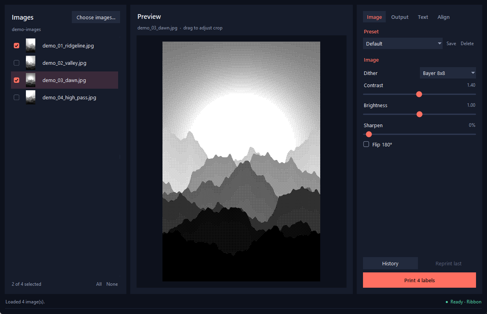
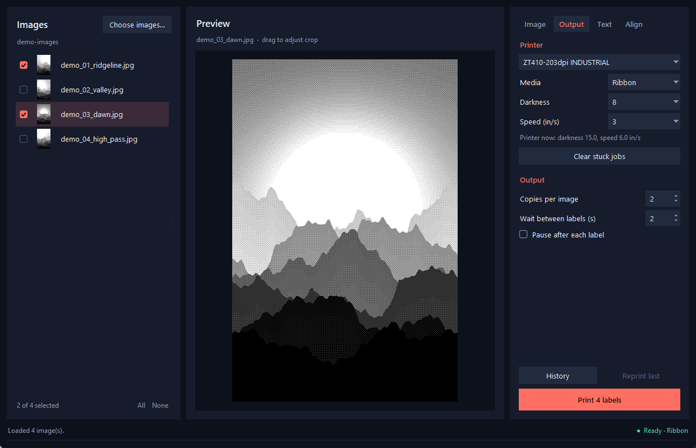

# Label Printer Tools

A Windows desktop app that prints photos and art (JPG and PNG) as 4×6 inch labels on a
Zebra ZT410 thermal printer. It sends images straight to the printer as ZPL, so no design or
photo software is needed.

The printer can only make black dots, so the app dithers each image to 1-bit at 203 DPI and
shows the result in a live preview before anything prints.



## Features

- Live preview with drag-to-crop
- Five dither modes: Bayer 8×8, Bayer 4×4, Floyd-Steinberg, Atkinson and Threshold
- Contrast, brightness and sharpen sliders, plus saved presets
- Ink ribbon or direct thermal, with darkness and speed control
- Text on labels, with label number, total, file name and date
- Batch printing with copies, a timed wait between labels, or a pause after each label
- Live printer status, such as Ready, Out of labels and Out of ribbon
- Print history with reprints
- Alignment controls and a calibration test pattern



*Screenshots use computer-generated demo images.*

## Requirements

- Windows 10 or 11
- A Zebra ZT410, 203 DPI, connected by USB and installed as a Windows printer
- 4×6 inch labels

Other Zebra printers may work, but they are untested. Live status only recognises the ZT410,
and the label size is set in the code.

## Download

Get `zebra_print.exe` from the [latest release](https://github.com/OM-Hawk/LABEL-PRINTER-TOOLS/releases/latest)
and run it. No install is needed.

The EXE is not code-signed, so Windows SmartScreen may warn you the first time. Choose
**More info**, then **Run anyway**, if you trust the download.

## Run from source

Needs Python 3.10 or newer.

```
pip install pillow pywin32 numpy tkinterdnd2
python zebra_print.py
```

While developing, `python dev.py` restarts the app on every save, even in the middle of a print.

## Before you print

- **Use the lowest darkness that looks good.** High darkness can burn through ribbon and wears
  the printhead. Photos have large dark areas, so start low and print one label first.
- **Match Media to what is loaded.** Use Ribbon with an ink ribbon, and Direct thermal only
  with no ribbon loaded.
- **Darkness, speed and media stay on the printer after a job.** They last until they are
  changed or the printer restarts. Choosing "Printer setting" reloads all of the printer's last
  saved settings, which also drops any unsaved changes made on the printer.
- **Calibrate with the test pattern.** Use the Align tab to set Move up/down, Move left/right and Image height for
  your labels.

## Clear stuck jobs

This button **deletes queued jobs for every printer on the PC**, not only the Zebra, and then
restarts the Windows print spooler. It needs admin rights, so Windows asks for permission.

## Settings

Settings and print history are stored in `%APPDATA%\ZebraPrint`.

## License

[MIT](LICENSE). This software comes with no warranty, including for printers, ribbons or labels.

Zebra and ZT410 are trademarks of Zebra Technologies. This project is not affiliated with Zebra.
